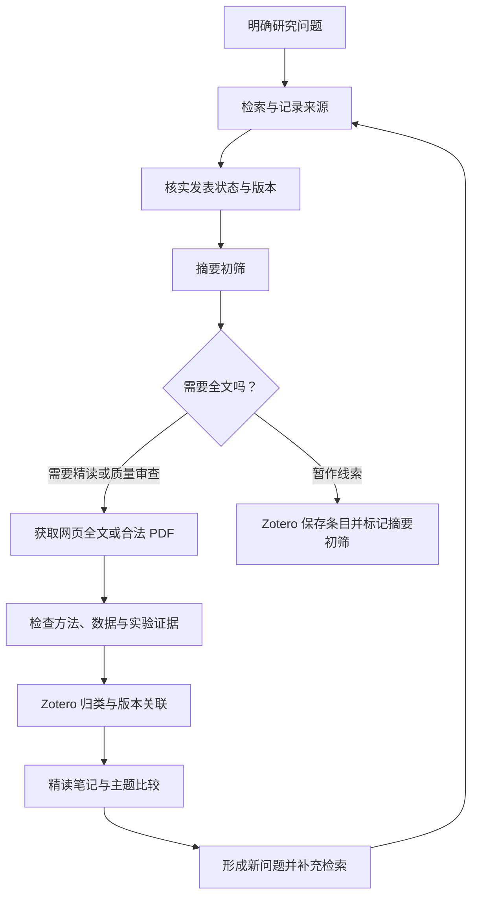

# Paper Research：从研究问题到个人文献知识库

一套面向个人学习与研究的通用文献工作流：提出问题、检索来源、判断质量、按需获取全文、整理到 Zotero，再形成可追溯的学习笔记。适用于经济学、财政学及其他领域。

本仓库提供操作指南和可复制模板，**不是已经实现全自动检索、下载、入库的程序**。使用者可以手动执行，也可以让具备浏览器、文件和 Zotero 工具权限的助手协助执行。

## 先跑通一篇

1. 写一个明确问题，例如“地方财政压力如何影响公共服务供给？”
2. 在 Google Scholar 或领域数据库检索，选出 5 篇候选；同时找综述或基础文献。
3. 核实出处、发表状态和版本，阅读摘要后决定哪些值得获取全文。
4. 从出版方、作者主页、机构仓储或学校图书馆获取全文；网页全文可读时不必另存 PDF。
5. 把条目存入 Zotero，检查作者、年份、DOI、版本与附件，放进主题分类。
6. 依据完整正文检查研究设计与证据，再决定是否进入精读清单。
7. 用[阅读模板](templates/reading-note.md)记录结论、证据定位、局限与自己的理解。

## 仓库内容

- [操作流程：来源、下载时机、获取与入库](docs/workflow.md)
- [质量筛选与跨领域迁移](docs/quality-and-transfer.md)
- [可直接使用的任务指令](docs/prompts.md)
- [论文阅读笔记模板](templates/reading-note.md)
- [检索与处理记录表](templates/search-log.csv)

## 工具分工

| 工具 | 负责什么 | 不应误认为 |
|---|---|---|
| 学术搜索、数据库、会议或期刊官网 | 发现文献、核实出处 | 搜索排名等于质量排序 |
| 浏览器与学校图书馆 | 阅读正文、完成机构认证、下载可访问文件 | 安装浏览器就获得订阅权限 |
| Zotero | 题录、附件、分类、标签与引用管理 | 条目存在就代表全文已保存 |
| Obsidian 或普通 Markdown 文件夹 | 精读笔记、比较表和主题索引 | 必须安装才能开始阅读 |
| 研究助手 | 协助检索、提取、解释和整理 | 能替代原文核对或保证论文正确 |

## 已验证与尚待配置

这套实践已经验证：本地 Zotero 连接、创建文献条目、保存作者与摘要、建立分类和标签、入库后读取核验。

全文批量下载并未实现端到端验证；浏览器控制、机构认证、站点限制和连接器版本均影响结果。不能把“条目已入库”报告成“PDF 已下载”。仅有摘要时，只能形成摘要导读，不能宣称已完成精读或严格质量评审。

建议先完成 1 篇“检索—全文—入库—讲解”的验收，再扩大到每批 5–10 篇。这个批量大小是操作建议，不是数据库服务限额。

## 参考入口

- [Zotero 下载](https://www.zotero.org/download/)、[快速入门](https://www.zotero.org/support/quick_start_guide)、[保存条目](https://www.zotero.org/support/adding_items_to_zotero)
- [Zotero Connector](https://www.zotero.org/download/connectors)：浏览器保存文献的常规入口。
- [Zotero MCP 第三方项目](https://github.com/cookjohn/zotero-mcp)：可选连接方式，安装与支持能力以其当前文档为准。
- [Obsidian](https://obsidian.md/)：可选笔记工具。

本仓库不分发论文全文、机构账号、浏览器登录状态或个人文献库。复用指南时，请保留文献出处和处理状态。
